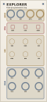

# Grandsummoner Explorer

> **12 HP Field-Programmable Tape-Cloud Delay, Diffusion Reverb & Shimmer Bloom**

  

---

## Overview

**Explorer** is a 12 HP spatial effects module for [VCV Rack v2](https://vcvrack.com/), combining an analog-modeled tape delay, an expansive diffusion reverb network, and an octave-up pitch-shifted shimmer bloom. Built around tape-loop physics and dense multi-tap delay networks, Explorer delivers everything from subtle vintage tape warmth and slapback echoes to infinite frozen ambient soundscapes.

Explorer is engineered for hands-on live performance and deep modular generative patches. It features genuine tape-motor inertia emulation (smoothing delay-time modulation into authentic mechanical pitch glides), dedicated CV inputs for every primary axis, and a trio of tactile latching performance buttons.

---

## The Grandsummoner Module Family

Explorer is a core member of the **Grandsummoner Eurorack Family**, designed to form a complete, unified modular synthesis ecosystem:

| Module | Width | Primary Function | Role in Ecosystem |
| :--- | :--- | :--- | :--- |
| **Spaces Command** | 38 HP | Dual-Scene Probabilistic CV/Gate Sequencer & Arpeggiator | Master Composition & Clock Brain |
| **Beams** | 18 HP | Quad Algorithmic Euclidean Drum Engine & Sampler | Rhythm, Percussion & Clock Sync |
| **Stellar** | 14 HP | Dual-Voice Multi-Model Synthesizer Companion | Primary Melodic & Harmonic Voice |
| **Intel** | 14 HP | Modulation Matrix, Dual FX Engine & Metering Ladder | Utility, Inter-Module Modulation & Modulation Router |
| **Explorer** | 12 HP | Tape-Cloud Delay, Diffusion Reverb & Octave Shimmer | Master Spatialization, Diffusion & Ambient Textures |

### Shared Design Language
Every Grandsummoner module shares an elegant vintage-laboratory aesthetic:
- **Warm Sand Cards** (`#F5F1E9` top gradient down to `#EDE7DC`) framed by hairline `0.4–0.5pt` bronze borders (`#8A7F6A`).
- **Deep Obsidian Knobs** with ivory indicator lines (`#E8E0D0`).
- **Tactile Color-Coded Performance Buttons**: Navy/Teal (`#2E4A6E`) for stereo imaging, Maroon (`#8A2A2A`) for freeze/muting, and Brass (`#8A6423`) for harmonic enrichment.
- **Center-Detent Micro-Dots** on bipolar knobs (`WIDTH`, `COLOR`) for instant zero-position alignment.

### Standalone vs. Family Operation
- **100% Standalone**: Explorer operates completely independently. All audio I/O and CV jacks adhere to standard Eurorack electrical specifications. Patch any external audio into `IN L/R` and modulate parameters using standard 0–10V or bipolar ±5V CV.
- **Universal Adjacency Link**: When placed directly adjacent to any Grandsummoner family module (**Spaces Command**, **Intel**, **Beams**, or **Stellar**) on either the left or right side, Explorer's side connector LEDs (`LINK L` and `LINK R`) automatically illuminate, confirming physical enclosure alignment.

### Cross-Module Synergies
- **With Stellar**: Send Stellar's `MASTER L/R` outputs directly into Explorer's `IN L/R`. Engaging `SHIMMER` and `FREEZE` transforms Stellar's Moog-style ladder filter plucks into sustained orchestral pads.
- **With Spaces Command**: Modulate Explorer's `TIME CV` and `REGEN CV` from Spaces Command's Voice 2 auxiliary pitch and gate outputs for rhythmic delay flutter locked to sequence transitions.
- **With Intel**: When Intel's modulation channels are active, use Intel's `TRIG 1–4` outputs to trigger Explorer's `FREEZE` or `SHIMMER` CV jacks on selected rhythmic beats.
- **With Beams**: Route Beams' stereo drum output into Explorer with a subtle `WIDTH` boost and 15% `MIX` for tape-warmed studio room reverberation.

---

## User Guide & Controls
